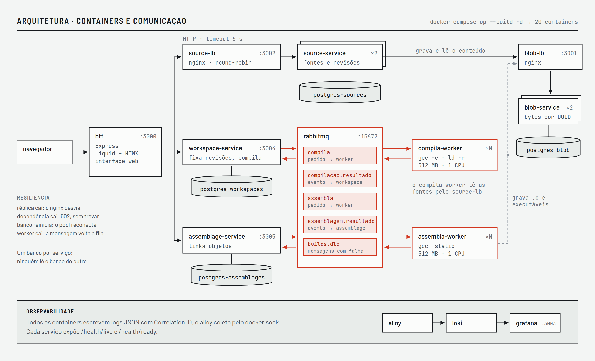

# Roteiro da apresentação (31/10)

Não vamos rodar o sistema ao vivo. Os slides explicam o projeto inteiro e mostram, com capturas reais, cada parte funcionando: as telas, os logs no Grafana e as saídas de terminal (réplicas, escala e teste de carga). São **26 slides, cerca de 17 minutos**, em 4 partes, uma por pessoa. Dos 25 minutos do grupo, sobram cerca de 3 para perguntas, além dos 5 de feedback.

| Quem | Parte | Slides | Tempo |
|---|---|---|---|
| **Apresentador 1:** _nome_ | Visão geral e arquitetura | 1 a 8 | 4 min 55 s |
| **Apresentador 2:** _nome_ | Serviço de blobs | 9 a 11 | 3 min 10 s |
| **Apresentador 3:** _nome_ | Serviço de fontes e integração | 12 a 18 | 4 min 55 s |
| **Apresentador 4:** _nome_ | Decisões, desempenho e evolução | 19 a 26 | 4 min 05 s |

O texto completo de cada slide está nas notas do apresentador. As falas abaixo são um guia.

## As duas imagens que todo mundo precisa conhecer

Qualquer pergunta sobre "como funciona" se responde com uma destas duas imagens. Elas estão nos slides 5 e 7 e no README.

**Fluxo: do fonte ao executável.** Arquivos com revisões → workspace compila num `.o` (fila `compila`) → assemblagem linka num executável (fila `assembla`) → download. O blob-service guarda todos os bytes.


**Arquitetura: os 20 containers.** O caminho síncrono aparece em preto (bff → serviços, nginx na frente das réplicas) e o assíncrono em vermelho (RabbitMQ, workers e eventos). Cada serviço tem o próprio Postgres, e a observabilidade fica embaixo.



## Antes de começar

- [ ] Preencher os nomes na capa dos slides e no README.
- [ ] Ensaiar com cronômetro: as partes 1 e 3 são as mais longas, com cerca de 5 min cada.
- [ ] Abrir os slides no modo apresentação, com as notas visíveis para quem fala.
- [ ] Ter o repositório aberto (GitHub ou VS Code), caso o professor peça para ver um arquivo: `docker-compose.yml`, um ADR ou `docs/slos.md`.

## Parte 1 · Visão geral e arquitetura (Apresentador 1)

| Slide | O que falar |
|---|---|
| 1. Capa (15 s) | Apresentar o grupo. Numa frase: "uma toolchain C em microsserviços: fontes com revisões, workspaces que compilam num objeto e assemblagens que linkam num executável". |
| 2. Problema (40 s) | São três cargas com perfis opostos: ler e salvar é leve, guardar bytes é genérico, compilar é lento e roda código de terceiros. Num monolito, um pico de compilações deixaria a leitura lenta. |
| 3. Por que microsserviços (30 s) | O domínio tem fronteiras claras. Com honestidade: num time pequeno real, a aula recomendaria um monolito modular primeiro. A maturidade operacional é parcial (não temos CI/CD). |
| 4. Bounded contexts (40 s) | A linguagem do domínio: fonte, revisão, workspace, objeto, assemblagem, blob. O blob é genérico e os workers não têm estado. |
| 5. **Fluxo** (50 s) | Contar o exemplo da calculadora sobre a imagem: 3 arquivos → 2 workspaces → 1 assemblagem → executável. O que está em vermelho passa pela fila. |
| 6. Arquitetura resumida (40 s) | As duas linhas: síncrona em cima, assíncrona embaixo. O que está em vermelho escala. |
| 7. **Arquitetura detalhada** (45 s) | Os 20 containers: síncrono em preto, filas e eventos em vermelho, um banco por serviço, observabilidade embaixo. |
| 8. Um comando sobe tudo (35 s) | Saída real do `docker compose ps`: 20 containers. A ordem de subida é garantida por healthchecks. Testamos a partir de um clone limpo. |

**Passagem:** "O serviço que todos os outros usam é o de blobs. Com vocês, _nome do Apresentador 2_."

## Parte 2 · Serviço de blobs (Apresentador 2)

| Slide | O que falar |
|---|---|
| 9. Serviço de blobs (70 s) | Guarda bytes por UUID e não sabe o que são. Fonte, `.o` e executável usam o mesmo serviço sem mudar nada nele (ADR-001). A API é mínima, o md5 é calculado pelo Postgres e cada dono guarda o seu `blob_id`. |
| 10. Réplicas e falhas (60 s) | Com uma réplica derrubada, 20 de 20 leituras responderam. Com o blob todo fora, a leitura responde 502 em 1 s (antes respondia 200 vazio, um bug achado pela análise do grupo). Limite: o BYTEA não serve para arquivos grandes, e o próximo passo é MinIO ou S3. |
| 11. **Na prática** (60 s) | Ler o terminal de cima para baixo: o X-Upstream alterna entre as réplicas; `docker stop` numa delas e as leituras continuam 200; `docker start` e, cerca de 20 s depois, ela volta sozinha ao revezamento. |

**Passagem:** "O blob guarda os bytes; quem dá sentido a eles é o serviço de fontes. _Nome do Apresentador 3_."

## Parte 3 · Serviço de fontes e integração (Apresentador 3)

| Slide | O que falar |
|---|---|
| 12. Serviço de fontes (45 s) | Revisões imutáveis: salvar sempre cria a REV n+1, com o número calculado dentro do UPDATE, então não há corrida entre dois salvamentos. É o serviço mais usado, com 2 réplicas. |
| 13. **Tela de arquivo** (35 s) | O `calc.c` na REV 2: a REV 1 continua lá. À direita, as revisões e os workspaces que usam o arquivo. |
| 14. Fila e evento de volta (45 s) | O workspace vai para a fila, o worker compila, grava no blob e devolve o evento "compilei". A entrega é "pelo menos uma vez" e o consumidor é idempotente. |
| 15. **Telas de workspace** (50 s) | À esquerda, compilado: duas fontes em revisões fixas viraram um `.o` de 1,3 kB. À direita, com erro: a mensagem do gcc volta para a tela, com a linha. |
| 16. **Tela de assemblagem** (40 s) | Os dois objetos linkados num executável de 137 kB. No terminal: `./calculadora` imprime `dobro(21) = 42, quadrado(7) = 49`. Ele nunca é executado no servidor. |
| 17. Correlation ID (40 s) | O ID nasce no bff e passa por header HTTP e dentro das mensagens. Alloy, Loki e Grafana coletam e mostram. Os logs ajudaram a achar dois bugs. |
| 18. **Grafana na prática** (40 s) | Uma compilação, filtrada por um único ID: 16 linhas de 6 componentes em 26 ms, do `POST /compilar` até "workspace vinculado". |

**Passagem:** "Por fim, as decisões que nos trouxeram até aqui e os números. _Nome do Apresentador 4_."

## Parte 4 · Decisões, desempenho e evolução (Apresentador 4)

| Slide | O que falar |
|---|---|
| 19. ADRs (30 s) | São 12 ADRs, no template da aula. Destacar o 004 → 011 (refizemos a compilação seguindo a proposta original) e o 008 (segurança dos workers). |
| 20. ADR-005 → 006 (25 s) | Começamos com um banco e um schema por serviço, descobrimos tudo no schema `public` e passamos para um banco por serviço. O 005 não foi apagado: virou *Superseded*. |
| 21. Desempenho (35 s) | O protocolo do grupo: 6.000 de 6.000 requisições válidas, p50 de 1,33, p95 de 1,64 e p99 de 1,81 ms. Ressalva: o teste foi na mesma máquina, e por isso as metas não foram apertadas. |
| 22. Carga e escala (25 s) | 800 req/s sem erro; com 2 workers, 8 compilações se dividiram em 4 e 4; disponibilidade composta de 99,6 %. |
| 23. **Escala e carga na prática** (45 s) | Um comando sobe 3 workers e o RabbitMQ confirma 3 consumidores. Teste misto do k6: todos os limites atendidos, 3.809 requisições e 0 falhas. |
| 24. Segurança (30 s) | O risco é compilar código de qualquer pessoa. O programa nunca é executado, e o gcc roda sem shell, com timeout e com limites. Lacunas declaradas: autenticação, rate limit e TLS interno. |
| 25. Deploy e evolução (30 s) | Rolling update já é viável: serviços sem estado, health checks e filas que devolvem a mensagem. O canary seria no bff. O Strangler Fig não se aplica, porque não viemos de um monolito. |
| 26. Encerramento (25 s) | Retomar cada entrega exigida e onde ela está no repositório. "Obrigado, perguntas?" |

## Feedback e peer review (5 min)

- **Apresentador 4** anota o feedback do professor e do grupo parceiro. Depois da aula, pelo menos um ADR precisa ser revisado com esse feedback (é critério de avaliação: 5 %).
- **Enquanto o outro grupo apresenta**, _nome_ preenche o checklist de peer review e entrega ao professor ao final da apresentação deles.

## Se perguntarem "por que não rodaram ao vivo?"

O plano de ensino prevê a demonstração ao vivo do Docker Compose. Os slides 8, 11, 16, 18 e 23 trazem saídas reais do ambiente rodando. Se o professor quiser ver ao vivo, um notebook com Docker sobe tudo em cerca de 35 s (com as imagens já baixadas):

```bash
docker compose up --build -d
docker compose ps
```

Depois é só abrir http://localhost:3000. O passo a passo completo está no README.
